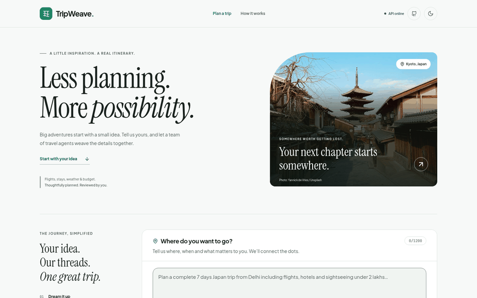
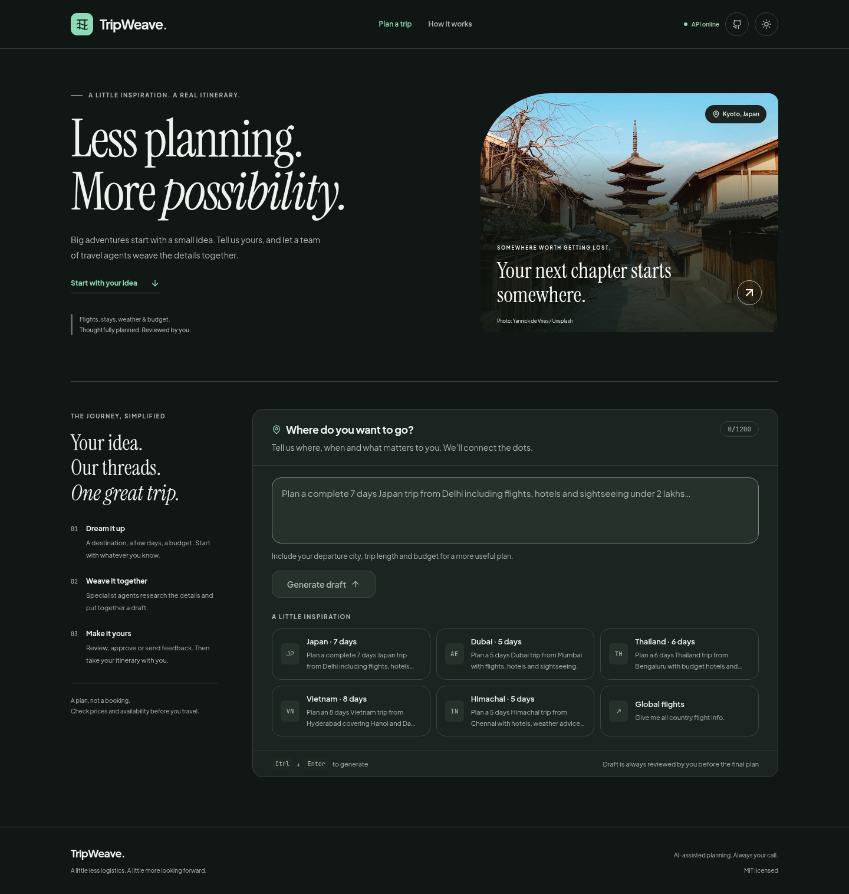
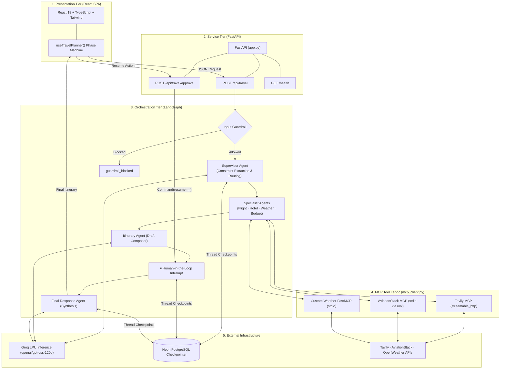

<p align="center">
  
</p>

<p align="center">
  <strong>Weave your next adventure.</strong>
</p>

<p align="center">
  An AI-powered multi-agent travel-planning workspace that turns natural-language requests into grounded, budget-aware itineraries through supervisor orchestration, specialized MCP tools, and human-in-the-loop draft review.
</p>

<p align="center">
  <a href="https://tripweave-mq1h.onrender.com"></a>
  <a href="#-technical-documentation-directory"></a>
  <a href="https://www.python.org/"></a>
  <a href="https://langchain-ai.github.io/langgraph/"></a>
  <a href="https://fastapi.tiangolo.com/"></a>
  <a href="https://react.dev/"></a>
  <a href="https://www.typescriptlang.org/"></a>
  <a href="https://modelcontextprotocol.io/"></a>
  <a href="https://neon.tech/"></a>
  <a href="LICENSE"></a>
</p>

<p align="center">
  <a href="https://tripweave-mq1h.onrender.com"><strong>Explore Live Demo »</strong></a> &nbsp;|&nbsp;
  <a href="docs/getting-started.md">Getting Started</a> &nbsp;|&nbsp;
  <a href="docs/architecture.md">Architecture</a> &nbsp;|&nbsp;
  <a href="docs/agents.md">Agent Layers</a> &nbsp;|&nbsp;
  <a href="docs/verification.md">Verification Report</a>
</p>

---

## Application Showcase

TripWeave features an editorial, modern-minimal interface with neutral card surfaces, charcoal typography, and restrained emerald accents. Both light and dark themes are independently contrast-tuned to maintain WCAG accessibility across desktop and mobile form factors.

<p align="center">
  
</p>

### Desktop Experience

|                                       ☀️ Modern Minimal (Light Mode)                                       |                                         🌙 Midnight Emerald (Dark Mode)                                         |
| :--------------------------------------------------------------------------------------------------------: | :-------------------------------------------------------------------------------------------------------------: |
|         |                  |
| _Refined neutral base (`#F7F9F8`), solid card surfaces (`#FFFFFF`), and deep emerald accents (`#087855`)._ | _High-contrast dark base (`#111714`), elevated surfaces (`#1B2420`), and luminous emerald accents (`#8EDAB6`)._ |

### Mobile Responsive Workspace

|                                     📱 Mobile Planner (Light)                                     |                                       📱 Mobile Planner (Dark)                                        |
| :-----------------------------------------------------------------------------------------------: | :---------------------------------------------------------------------------------------------------: |
|  |  |
|   _Touch-first single-column composer, inspiration presets, and collapsible execution status._    |  _Night-optimized mobile planner with contrast-tuned input fields and accessible focus boundaries._   |

_Captured directly from the running React 18 frontend with verified API connectivity. The interface reflects the current Modern Minimal theme tokens, verified MIT licensing, and updated project branding. See [Verification & Project Status](#-verification-and-project-status) and [docs/verification.md](docs/verification.md)._

---

## Overview

Planning an international journey is a complex, constraint-heavy problem. Travellers must juggle flight routes, lodging options, seasonal weather forecasts, and strict budget ceilings. When handed to a single monolithic LLM prompt, this process regularly breaks down: models hallucinate nonexistent flights, invent lodging tariffs, produce schedules that contradict calendar dates, and quietly ignore budgetary caps.

**TripWeave solves this by decomposing travel planning into a coordinated multi-agent workflow:**

1. **Relevance Screening:** An input guardrail screens requests before execution, rejecting off-domain queries before spinning up expensive specialist tasks.
2. **Supervisor Decomposition:** A supervisor agent extracts core trip constraints (origin, destination, duration, budget, travel style) and dynamically selects only the necessary specialists.
3. **Tool-Grounded Retrieval:** Specialist agents gather verified facts through external [Model Context Protocol (MCP)](https://modelcontextprotocol.io/) servers covering flights, hotels, and meteorological conditions.
4. **Draft Synthesis & Human Review:** An itinerary agent synthesizes the findings into a preliminary draft and pauses execution via LangGraph's native `interrupt()`.
5. **Human-in-the-Loop Decision:** The traveller inspects the draft and can either **Approve & generate final** to polish the plan, or **Revise & Finalize** with specific feedback (e.g., _"reduce hotel budget, leave Day 4 free"_).
6. **Final Consolidation & Export:** The final response agent incorporates any feedback, formats a comprehensive seven-section itinerary, and provides instant light-mode PDF export and clipboard copying.

Every thread is durably persisted in PostgreSQL checkpoints, enabling pause-and-resume workflows to survive server restarts, redeployments, and extended review intervals.

---

## Key Features

- 🛡️ **Input Guardrail** — LLM-backed classification evaluates relevance and safety before routing. Off-domain requests exit through a dedicated blocked node, consuming exactly one model call.
- 🧠 **Supervisor Orchestration** — Dynamically parses requests into structured `trip_constraints` and determines `selected_agents` at runtime, bypassing unneeded specialists (e.g., weather inquiries skip flight lookups).
- ✈️ **Flight Specialist** — Synthesizes airport and airline data via AviationStack MCP into route choices, typical flight durations, carrier options, and seasonal booking guidance.
- 🏨 **Hotel Specialist** — Discovers curated, cited lodging recommendations matching traveller style and constraints through real-time Tavily MCP search.
- 🌦️ **Weather Specialist** — Retrieves current weather observations and multi-slot forecasts for the target destination via a custom FastMCP server wrapping OpenWeather.
- 💰 **Budget Analyst** — Pressure-tests the itinerary against stated budget ceilings, highlighting major cost drivers, reserve buffers, and potential savings levers.
- 🗓️ **Draft Itinerary Composer** — Combines specialist findings into a cohesive day-by-day plan structured specifically for human inspection.
- 👤 **Human-in-the-Loop Interrupt** — Uses native LangGraph `interrupt()` to suspend graph execution. State is checkpointed to PostgreSQL until the user approves or requests revisions.
- 🔁 **Dual Finalization Pathways** — Supports both **Approve & generate final** (polishing existing draft) and **Revise & Finalize** (incorporating revision feedback). Both pathways finalize the itinerary cleanly without recursive review loops.
- 📄 **Static PDF Export** — Eager module-level `html2pdf.js` loading (jsPDF 4.2.1) ensures reliable one-click A4 export with light-mode token forcing and table page-break protection even when browsing in dark mode.
- 🌓 **Modern Minimal UI** — Built with React 18, TypeScript, and Tailwind CSS. Features neutral card surfaces, subtle emerald accents, serif editorial headings, and WCAG-compliant contrast tuning.

---

## Architecture Summary

TripWeave separates presentation, service boundaries, orchestration, external integrations, and persistent state into clean, decoupled tiers:



### Architectural Principles

- **Single Shared State:** All agents read from and write to a unified `TravelState` TypedDict. Downstream specialists (such as Budget and Itinerary) consume earlier retrieved data without redundant network queries.
- **Dynamic Conditional Routing:** Execution order follows a fixed topological sequence (`AGENT_ORDER`), but node activation is governed dynamically by the supervisor's `selected_agents` list.
- **Fail-Safe Tool Degradation:** External MCP servers load lazily per server. If an API key is missing or a subprocess fails, the affected agent injects an explicit fallback instruction into the state, prompting the model to degrade transparently rather than aborting the workflow.
- **Token Budgeting & Overlap Stripping:** Prompts are dynamically budgeted using `_fit_sections()` to stay within Groq tokens-per-minute limits. Length continuations discard partial lines and deterministically strip exact line-boundary overlap (≥ 32 chars) via `_join_continuation()`.

For in-depth architectural details, component interactions, and state schemas, see [docs/architecture.md](docs/architecture.md) and [docs/agents.md](docs/agents.md).

---

## Tech Stack

| Layer                   | Technology                                                                                                              | Role in TripWeave                                                                        |
| ----------------------- | ----------------------------------------------------------------------------------------------------------------------- | ---------------------------------------------------------------------------------------- |
| **Frontend UI**         | [React 18.3](https://react.dev/), [TypeScript 5.6](https://www.typescriptlang.org/)                                     | Single-page planner, phase state machine, and reactive thread state                      |
| **Styling & Animation** | [Tailwind CSS 3.4](https://tailwindcss.com/), [Framer Motion 11](https://www.framer.com/motion/)                        | Modern minimal design system, neutral surfaces, emerald accents, and layout transitions  |
| **Frontend Build**      | [Vite 5.4](https://vite.dev/)                                                                                           | High-speed local HMR development and optimized production bundling                       |
| **Backend Framework**   | [FastAPI 0.136](https://fastapi.tiangolo.com/), [Uvicorn 0.48](https://www.uvicorn.org/)                                | Asynchronous REST API, request schema validation, and single-origin SPA serving          |
| **Agent Orchestration** | [LangGraph 1.2.2](https://langchain-ai.github.io/langgraph/), [LangChain 1.3.2](https://python.langchain.com/)          | Stateful multi-agent graph, conditional routing, and `interrupt()` human review          |
| **Inference Provider**  | [Groq LPU](https://groq.com/) (`openai/gpt-oss-120b`)                                                                   | High-speed inference with dynamic token budgeting and length continuation                |
| **Tool Protocol (MCP)** | [Model Context Protocol](https://modelcontextprotocol.io/) (`mcp 1.28`, `langchain-mcp-adapters 0.3`)                   | Unified tool client managing streamable HTTP and stdio subprocess servers                |
| **Custom Tool Server**  | [FastMCP](https://github.com/jlowin/fastmcp)                                                                            | Local custom weather MCP server exposing OpenWeather current and forecast tools          |
| **External APIs**       | [Tavily](https://tavily.com/), [AviationStack](https://aviationstack.com/), [OpenWeather](https://openweathermap.org/)  | Grounded search for lodging discovery, flight route metadata, and meteorology            |
| **Checkpoint Storage**  | [Neon PostgreSQL](https://neon.tech/), [`langgraph-checkpoint-postgres 3.1`](https://github.com/langchain-ai/langgraph) | Durable thread checkpointing across server restarts via `psycopg 3` connection pool      |
| **PDF & Markdown**      | `html2pdf.js 0.14`, `jsPDF 4.2.1`, `DOMPurify 3.4.17`, `react-markdown`                                                 | Static client-side PDF export, sanitize pipeline, and GitHub Flavored Markdown rendering |
| **Containerization**    | [Docker](https://www.docker.com/) (`node:20-slim` + `python:3.11-slim`)                                                 | Multi-stage production build bundling the compiled React SPA and Python backend          |
| **Deployment**          | [Render](https://render.com/) Web Service                                                                               | Hosted container deployment serving frontend assets and REST API on a single origin      |

---

## Quick Start

### Prerequisites

- **Python 3.11+**
- **Node.js 18+** with `npm`
- **PostgreSQL** database (local instance or remote like [Neon](https://neon.tech/))
- **[uv / uvx](https://docs.astral.sh/uv/)** installed and available on your system `PATH` (required for AviationStack stdio MCP)
- API credentials: [Groq](https://console.groq.com/keys), [Tavily](https://app.tavily.com/), [AviationStack](https://aviationstack.com/), and [OpenWeather](https://openweathermap.org/api)

### 1. Clone & Set Up Python Environment

```bash
git clone https://github.com/TheQuantumPanda/TripWeave.git
cd TripWeave

# Create and activate virtual environment
python3 -m venv .venv
source .venv/bin/activate  # Windows: .venv\Scripts\Activate.ps1

# Install backend dependencies
pip install -r requirements.txt
```

### 2. Install Frontend Dependencies

```bash
cd frontend
npm install
cd ..
```

### 3. Configure Environment Variables

Create your local `.env` file from the example template:

```bash
cp .env.example .env
```

Configure your credentials in `.env`:

| Setting                  | Purpose                                                                    |
| ------------------------ | -------------------------------------------------------------------------- |
| `GROQ_API_KEY`           | Groq LPU inference key (required, fails fast on startup if missing)        |
| `DATABASE_URL`           | PostgreSQL connection string (`sslmode=require` appended if absent)        |
| `TAVILY_API_KEY`         | Hotel and destination search via hosted Tavily MCP                         |
| `AVIATION_STACK_API_KEY` | Flight and airline reference data (alias `AVIATIONSTACK_API_KEY` accepted) |
| `OPENWEATHER_API_KEY`    | Current weather and 5-day forecast data                                    |

_Never commit `.env` or share private keys. See [docs/getting-started.md](docs/getting-started.md) for optional tuning variables (`GROQ_TPM_LIMIT`, `GROQ_MODEL`, `DB_POOL_MAX_SIZE`)._

### 4. Run Locally

#### Development Mode (Two Processes)

FastAPI runs on port 8000, and the Vite dev server runs on port 5173 with hot module reloading:

```bash
# Terminal 1 — Backend API
python app.py

# Terminal 2 — Frontend UI
npm --prefix frontend run dev
```

Open **http://127.0.0.1:5173** in your browser. Vite automatically proxies `/api` and `/health` calls to port 8000.

#### Production Mode (Single Process)

Compile the React frontend to `frontend/dist`, then let FastAPI serve the SPA directly:

```bash
# Build the production bundle
npm --prefix frontend run build

# Start the unified server
python app.py
```

Open **http://127.0.0.1:8000**. FastAPI serves `frontend/dist/index.html` at `/` and hashed assets at `/assets/`.

#### Docker Run

Build and run the multi-stage container locally:

```bash
docker build -t tripweave .
docker run --rm -p 8000:7860 --env-file .env tripweave
```

Open **http://127.0.0.1:8000** in your browser.

---

## Live Deployment

TripWeave is deployed as a containerized web service:

- **Live Application:** [https://tripweave-mq1h.onrender.com](https://tripweave-mq1h.onrender.com)
- **Deployment Platform:** [Render](https://render.com/) Docker Web Service
- **Unified Serving:** FastAPI serves both the REST API endpoints and the compiled React production SPA on the same origin (`/` and `/assets/`)
- **Durable Checkpoints:** Remote [Neon PostgreSQL](https://neon.tech/) connection pool preserves conversation threads across container lifecycles
- **Secrets Management:** Configured via server-side environment variables without exposing sensitive credentials to client code

> [!NOTE]
> **Free-Tier Cold Starts:** Because the live demo is hosted on Render's free tier, the instance automatically spins down after periods of inactivity. Initial requests may take 30–50 seconds to complete while the container launches and initializes database connections. Subsequent requests respond with normal latency.

---

## Verification and Project Status

TripWeave's verification status is grounded strictly in documented tests, reproducible checks, and recorded evidence:

| Capability / Check               |       Status       | Verification Scope & Evidence                                                                                                                                |
| -------------------------------- | :----------------: | ------------------------------------------------------------------------------------------------------------------------------------------------------------ |
| **Offline Unit & Logic Tests**   |      **PASS**      | 27/27 pytest tests passing; covers boundary fit, continuation overlaps, prompt constraints, and state transitions using in-memory mocks.                     |
| **Frontend Typecheck & Build**   |      **PASS**      | TypeScript strict mode clean; Vite 5.4 production build transforms 2,595 modules in ~4.6s.                                                                   |
| **Browser Regression Suite**     |      **PASS**      | 35 synthetic Playwright assertions passing; covers all quick prompts, composer locks, feedback inputs, error dismissals, and responsive widths (320–1440px). |
| **PDF Layout & Safety Checks**   |      **PASS**      | 19 assertions passing; confirms table page-break protection, HTML tag escaping, code block preservation, and text ordering.                                  |
| **Goa Realistic Fixture Export** |      **PASS**      | 106 assertions passing across light and dark themes using a 9,963-character realistic Goa itinerary; verified on Chromium and Zen 1.23 (Gecko).              |
| **Static PDF Runtime Loading**   |      **PASS**      | Module-level eager import of `html2pdf.js` verified; zero late script requests during export, even when subsequent network requests 404.                     |
| **Production Dependency Audit**  |      **PASS**      | `npm audit --omit=dev` reports 0 vulnerabilities across all 139 installed production dependencies.                                                           |
| **Development Dependency Audit** | **KNOWN FINDINGS** | Full `npm audit` reports 4 advisories in dev-only tooling (Vite, source-map-js, esbuild, postcss-selector-parser); none are bundled into client assets.      |
| **Local Live Multi-Agent Run**   |      **PASS**      | Successfully verified complete live planning cycle (draft generation, approval, feedback revision, and final response) using valid Groq and MCP credentials. |
| **Local Live PDF Download**      |      **PASS**      | Downloaded valid A4 draft and final PDFs from live model-generated plans.                                                                                    |
| **Hosted Service Liveness**      |      **PASS**      | Public `/health` endpoint on Render returns HTTP 200 with status `"ok"` and `"frontend": "react"`.                                                           |
| **Hosted Live Draft & Export**   |      **PASS**      | Public demo generated a multi-agent draft itinerary and successfully exported a client-side PDF.                                                             |
| **Hosted Approval Finalization** |  **UNCONFIRMED**   | End-to-end hosted approval and revision finalization has not been independently verified on the Render deployment.                                           |

_Synthetic browser checks test client behavior against local contracts and do not constitute live provider testing. Live provider calls consume external API quotas and depend on third-party service availability. For complete verification logs, bundle provenance, and test commands, consult [docs/verification.md](docs/verification.md)._

---

## Known Limitations and V2 Direction

### V1 Limitations

- **Advisory Cost Breakdowns:** The budget agent provides analytical estimates and feasibility assessments based on retrieved context, but does not perform deterministic mathematical balancing or ledger reconciliation.
- **Estimated Flight & Lodging Prices:** Flight data is drawn from airport and airline reference schedules via AviationStack rather than live commercial global distribution system (GDS) fare engines. Hotel prices reflect search-time quotes. All pricing requires independent verification prior to booking.
- **Date-Agnostic Flight Metadata:** Queries resolve to route reference data rather than departure calendar dates. Flight results reflect carrier operating patterns rather than confirmed seat inventory on specific dates.
- **Continuation Seam Deduplication:** `_join_continuation()` deterministically strips exact suffix/prefix repetitions (≥ 32 chars) at line boundaries. However, semantically paraphrased duplicate sections or re-introduced headings across continuation rounds are not detected.
- **Sequential Tool Execution:** Specialist agents run sequentially in `AGENT_ORDER`. Total generation latency is the sum of specialist execution times rather than their concurrent minimum.

> [!IMPORTANT]
> **Traveller Advisory:** TripWeave is an AI-assisted planning workspace. Generated itineraries, budgets, and flight options are estimates intended for exploration and inspiration. Always verify schedules, visa rules, and prices with airlines and booking providers before committing funds.

### V2 Roadmap Direction

- [ ] **Deterministic Budget Reconciliation:** Implement a structured Pydantic cost ledger that mathematically balances itemized categories against the stated ceiling.
- [ ] **Concurrent Agent Fan-Out:** Run independent retrieval agents (flight, hotel, weather) concurrently using `asyncio.gather()` or LangGraph parallel branches to reduce latency.
- [ ] **Real-Time Fare Pricing:** Integrate transactional travel APIs (such as Amadeus or Skyscanner) for bookable flight offers and live hotel inventory.
- [ ] **Calendar & Date Extraction:** Extract explicit departure and return dates during supervisor analysis to ground flight schedules and weather forecasts in precise travel windows.
- [ ] **Streaming Token Delivery:** Replace bulk phase responses with Server-Sent Events (SSE) via `graph.astream()` for live token streaming.

---

## 📚 Technical Documentation Directory

The root README provides an executive overview. Detailed technical documentation is maintained in [`docs/`](docs/):

| Document                                                 | Purpose                                                                                                             |
| -------------------------------------------------------- | ------------------------------------------------------------------------------------------------------------------- |
| [**`docs/getting-started.md`**](docs/getting-started.md) | Installation, environment configuration, local development modes, Docker setup, and token budgeting                 |
| [**`docs/architecture.md`**](docs/architecture.md)       | Layered architecture, LangGraph state topology, `TravelState` design, persistence, and request lifecycle            |
| [**`docs/agents.md`**](docs/agents.md)                   | Input guardrail classification, supervisor routing logic, specialist responsibilities, and HITL interrupt mechanics |
| [**`docs/mcp.md`**](docs/mcp.md)                         | Model Context Protocol integration, multi-server client architecture, custom FastMCP server, and fallback handling  |
| [**`docs/api.md`**](docs/api.md)                         | FastAPI endpoint reference (`/api/travel`, `/api/travel/approve`, `/health`), JSON schemas, and cURL walkthrough    |
| [**`docs/frontend.md`**](docs/frontend.md)               | React SPA architecture, `useTravelPlanner` phase state machine, Tailwind tokens, and static PDF export              |
| [**`docs/verification.md`**](docs/verification.md)       | Comprehensive test records, synthetic browser assertions, Goa realistic fixture results, and security audit         |
| [**`docs/design-notes.md`**](docs/design-notes.md)       | Engineering rationale, architectural trade-offs, known limitations, and future roadmap                              |
| [**`CONTRIBUTING.md`**](CONTRIBUTING.md)                 | Contribution guidelines, local validation commands, and workflow for adding agents or MCP servers                   |

---

## Attribution and License

TripWeave is released under the [MIT License](LICENSE).

```text
MIT License
Copyright (c) 2026 TheQuantumPanda
```

### Acknowledgements

- [LangGraph](https://langchain-ai.github.io/langgraph/) — Stateful multi-agent graph orchestration, conditional routing, and durable interrupts
- [Model Context Protocol](https://modelcontextprotocol.io/) — Open standard for connecting LLMs to external data sources
- [Groq](https://groq.com/) — High-speed LPU inference
- [FastAPI](https://fastapi.tiangolo.com/) — Modern asynchronous Python web framework
- [Tavily](https://tavily.com/) — Search API engineered for AI agent grounding
- [AviationStack](https://aviationstack.com/) — Global aviation data provider
- [OpenWeather](https://openweathermap.org/) — Global meteorological forecasts
- [Neon](https://neon.tech/) — Serverless PostgreSQL cloud database
