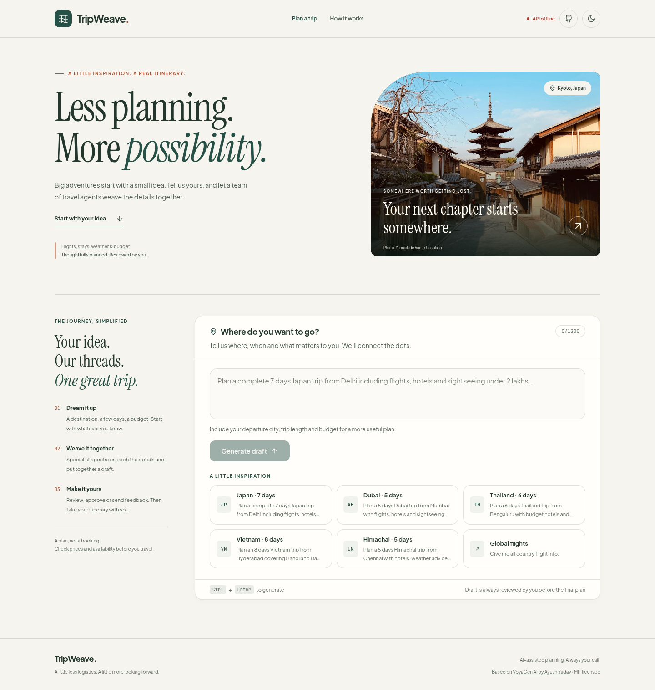
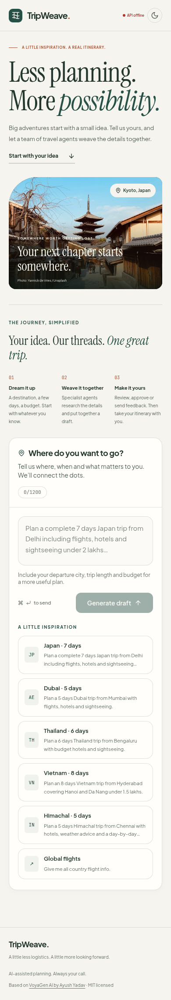
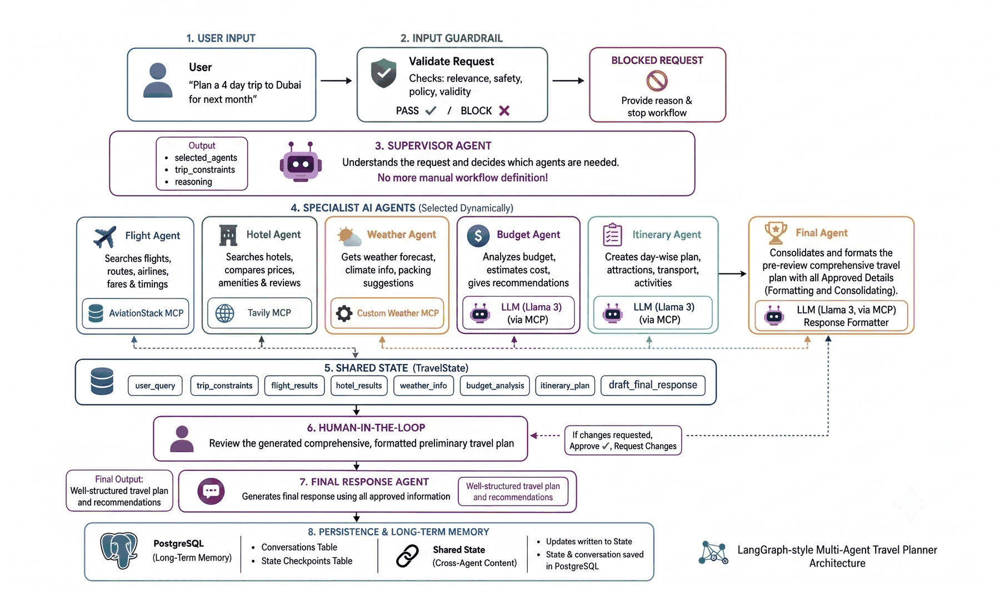

<div align="center">



# TripWeave

### A supervisor-routed, guardrailed, human-in-the-loop multi-agent travel planner

*Turn one sentence — "Plan a 7-day Japan trip from India under ₹2 lakhs" — into a grounded,
budget-aware draft that you review, then **approve or revise to produce your final plan**.*

[](https://www.python.org/)
[](https://langchain-ai.github.io/langgraph/)
[](https://modelcontextprotocol.io/)
[](https://fastapi.tiangolo.com/)
[](https://react.dev/)
[](https://www.typescriptlang.org/)
[](https://tailwindcss.com/)
[](https://www.postgresql.org/)
[](https://groq.com/)
[](https://www.docker.com/)
[](LICENSE)

</div>

---

## 📚 Documentation

This README is the tour. The detail lives in [`docs/`](docs/).

| Guide | What's in it |
| --- | --- |
| **[Getting Started](docs/getting-started.md)** | Prerequisites, install, environment variables, running in dev and production, Docker |
| **[Architecture](docs/architecture.md)** | The layered system, the LangGraph topology, `TravelState`, checkpointing, the full request lifecycle |
| **[The Agent Layers](docs/agents.md)** | Input guardrail, supervisor routing, dynamic edge resolution, the human-in-the-loop interrupt |
| **[The MCP Tool Fabric](docs/mcp.md)** | Three MCP servers across two transports, per-server lazy loading, graceful degradation |
| **[Frontend](docs/frontend.md)** | The React SPA — phase machine, component tree, design tokens |
| **[API Reference](docs/api.md)** | Both endpoints, the full response contract, an end-to-end walkthrough |
| **[Design Notes](docs/design-notes.md)** | Why it is built this way, known limitations, roadmap |
| **[Contributing](CONTRIBUTING.md)** | How to add an agent, a tool, or a UI change |

---

## Verification status — 2 November 2026

The original frontend started and built successfully; the existing 13 offline tests passed.
The original backend could not start because `GROQ_API_KEY` was missing. No `.env`, database URL
or provider credentials were supplied. **Live planning, database persistence and external APIs
remain unverified.** The TripWeave makeover retains the existing backend and API contracts.
See [the baseline and final report](docs/verification.md) for checks, limitations and changed files.

## 🌍 Overview

**TripWeave** is an end-to-end, production-shaped **multi-agent system** that plans complete
trips from a single natural-language request. Rather than dropping one monolithic prompt on a
language model and hoping for the best, TripWeave decomposes travel planning into a **directed
graph of specialised agents**, each owning exactly one responsibility, all communicating through
a single typed, durably checkpointed state object.

Five things make it more than a demo:

| | |
| --- | --- |
| 🛡️ **Guardrailed** | Every request passes an LLM-backed relevance/safety check before a single specialist runs. Off-domain requests short-circuit the graph and return a reason. |
| 🧠 **Supervisor-routed** | A supervisor agent reads the request and *decides at runtime* which specialists are needed. A weather question never pays for a flight lookup. |
| 🔌 **MCP-grounded** | Facts come from three [Model Context Protocol](https://modelcontextprotocol.io/) servers — Tavily (hosted HTTP), AviationStack (stdio), and a custom weather server — not from the model's parametric memory. |
| 👤 **Human-in-the-loop** | The graph **interrupts** at a real LangGraph `interrupt()` after drafting the itinerary. Nothing is finalised until a person approves or sends revision feedback. |
| 💾 **Resumable** | State lives in PostgreSQL via LangGraph's `PostgresSaver`. A `thread_id` survives process restarts, redeploys, and horizontal scaling — which is exactly what makes the interrupt/resume cycle work at all. |

```text
User: "Plan a complete 7 day Japan trip from India including
       flights, hotels and sightseeing under 2 lakhs"

                            ⬇  guardrail: PASS
                            ⬇  supervisor: all 5 specialists
                            ⬇  flight · hotel · weather · budget · itinerary
                            ⬇  ⏸  INTERRUPT — awaiting your review
                            ⬇  you: "reduce the hotel cost, add a free day"
                            ⬇  final agent re-synthesises

TripWeave: 1. Trip Summary        5. Day-by-Day Itinerary
         2. Flight Information  6. Estimated Budget
         3. Hotel Suggestions   7. Final Recommendations
         4. Weather Information
```

---

## ✨ Key Features

| | Feature | Description |
| :-: | --- | --- |
| 🛡️ | **Input guardrail** | An LLM-backed classifier returns `{allowed, reason}` before routing. Off-domain requests exit through a dedicated `guardrail_blocked` node with an explanation. |
| 🧠 | **Supervisor agent** | Reads the request, extracts `trip_constraints` (destination, origin, duration, budget, style, preferences) and selects `selected_agents` — dynamic workflow definition, no hand-wired branches. |
| ✈️ | **Flight agent** | Airport and airline reference data from the **AviationStack MCP** server, synthesised into route options, carriers, durations, fare ranges and booking advice. |
| 🏨 | **Hotel agent** | Live, cited lodging discovery through the **Tavily MCP** server over streamable HTTP. |
| 🌦️ | **Weather agent** | Current conditions *and* a 5-slot forecast from a **custom FastMCP weather server** wrapping OpenWeather. |
| 💰 | **Budget agent** | Pressure-tests the plan against the stated ceiling: cost categories, risk areas, savings levers, feasibility verdict. |
| 🗓️ | **Itinerary agent** | Composes the day-by-day draft from everything above, explicitly framed as *ready for human review*. |
| 👤 | **Human-in-the-loop** | `langgraph.types.interrupt()` pauses the graph; `Command(resume=…)` restarts it with `approved` + `feedback`. |
| 💾 | **Durable memory** | PostgreSQL-backed checkpointing over a `psycopg_pool` connection pool; threads persist across restarts, redeploys and replicas. |
| ⚡ | **Fast inference** | Groq LPU inference (`openai/gpt-oss-120b`). |
| 🎨 | **Modern React UI** | Vite + React 18 + TypeScript + Tailwind + Framer Motion. Warm paper and forest-green palette, editorial typography, responsive planner, light/dark themes, specialist pipeline, markdown rendering and PDF export. |
| 🔌 | **Transparent JSON API** | Both endpoints return the final answer *plus* every intermediate artifact, the supervisor's reasoning, the guardrail verdict and an LLM-call counter. |
| 📊 | **LangSmith tracing** | Optional, env-gated observability across the whole graph. |
| 🐳 | **Containerised** | Two-stage build — Node compiles the SPA, Python 3.11-slim runs the API and serves it. `uv` included so the stdio MCP server works in-container. Healthcheck built in. |

---

## The TripWeave interface

An editorial travel workspace with a warm ivory canvas, forest-green controls, serif headings,
and a responsive planner. Describe a trip, inspect the selected specialists, review the draft,
then approve or send revision feedback. Copy the plan or download a PDF as before.



These screenshots show the real frontend with its API offline. Draft, approval, final, error,
copy and PDF states were also exercised with **browser-only synthetic responses**, separately
from live integration verification. See [verification and changed files](docs/verification.md).

---

## 🗺 Architecture at a Glance

The guardrail, the supervisor, each specialist with the MCP server behind it, how their outputs
land in the shared `TravelState`, the human review gate, and how everything is persisted:

<div align="center">
  
</div>

**Reading this diagram:**

- **Nothing runs before the guardrail.** A blocked request never reaches the supervisor, so an
  off-domain prompt costs exactly one LLM call.
- **The supervisor writes the workflow, the graph executes it.** `selected_agents` is data, not
  code — which is why adding a sixth specialist requires a node, a routing entry, and one line
  in the supervisor prompt, and nothing else.
- **Every agent writes into the *same* `TravelState`** rather than passing messages
  point-to-point. That is what lets the budget agent read flight and hotel results fetched two
  steps earlier without re-fetching, and the final agent see all of it at once.
- **The human sits inside the graph, not beside it.** Review happens at a checkpointed pause
  between the draft and final synthesis. Approval polishes the draft; revision applies feedback
  and finalizes it. Neither action starts another review cycle.
- **State is checkpointed after each step**, so a restart mid-run resumes from the last completed
  node instead of losing the conversation.

> **Going deeper:** [Architecture](docs/architecture.md) covers the layered system, the LangGraph
> topology and state design · [The Agent Layers](docs/agents.md) covers the guardrail, supervisor
> and interrupt · [The MCP Tool Fabric](docs/mcp.md) covers the tool servers.

---

## ⚡ Quickstart

You need **Python 3.11+**, **Node 18+**, a **PostgreSQL** instance, **[uv](https://docs.astral.sh/uv/)**
on `PATH`, and API keys for Groq, AviationStack, Tavily and OpenWeather.

```bash
# Open your standalone TripWeave checkout
cd /path/to/TripWeave

# Python
python -m venv .venv && source .venv/bin/activate   # Windows: .\.venv\Scripts\Activate.ps1
pip install -r requirements.txt

# Front end
cd frontend && npm install && cd ..

# Configure — see docs/getting-started.md for every variable
cp .env.example .env      # then fill in your keys
```

Run it in development — two processes, Vite proxies `/api` to FastAPI:

```bash
python app.py                     # API on :8000
cd frontend && npm run dev        # UI on :5173
```

…or as one process, with FastAPI serving the built SPA:

```bash
cd frontend && npm run build      # → frontend/dist
cd .. && python app.py            # http://127.0.0.1:8000
```

Or with Docker — one build produces the API and the compiled UI together:

```bash
docker build -t tripweave .
docker run --rm -p 8000:7860 --env-file .env tripweave
```

Full setup, every environment variable, and the MCP connectivity smoke test are in
**[Getting Started](docs/getting-started.md)**.

---

## 🛠 Tech Stack

<table>
<tr><th align="left">Layer</th><th align="left">Technology</th><th align="left">Role</th></tr>
<tr><td rowspan="3"><b>Orchestration</b></td><td>LangGraph <code>1.2.2</code></td><td>Stateful multi-agent graph, conditional edges, interrupts, checkpointing</td></tr>
<tr><td>LangChain <code>1.3.2</code> · <code>langchain-groq</code></td><td>Message abstractions, model bindings</td></tr>
<tr><td><code>langgraph-checkpoint-postgres</code> <code>3.1.0</code></td><td>Durable thread state</td></tr>
<tr><td><b>Model serving</b></td><td>Groq — <code>openai/gpt-oss-120b</code></td><td>Low-latency LPU inference</td></tr>
<tr><td rowspan="2"><b>Tool fabric</b></td><td><code>langchain-mcp-adapters</code> <code>0.3.0</code> · <code>mcp</code> <code>1.28.1</code></td><td>MultiServerMCPClient across stdio + streamable HTTP</td></tr>
<tr><td>FastMCP</td><td>The custom weather MCP server</td></tr>
<tr><td rowspan="2"><b>Service</b></td><td>FastAPI <code>0.136</code> + Uvicorn <code>0.48</code></td><td>Async HTTP API, ASGI server</td></tr>
<tr><td><code>nest_asyncio</code></td><td>Lets sync graph nodes call async MCP tools via <code>asyncio.run()</code></td></tr>
<tr><td rowspan="5"><b>Frontend</b></td><td>React <code>18</code> + TypeScript <code>5.6</code></td><td>Typed component layer</td></tr>
<tr><td>Vite <code>5</code></td><td>Dev server, HMR, production bundling</td></tr>
<tr><td>Tailwind CSS <code>3.4</code></td><td>Token-driven utility styling</td></tr>
<tr><td>Framer Motion <code>11</code></td><td>Enter/exit and layout animation</td></tr>
<tr><td><code>react-markdown</code> + <code>remark-gfm</code> · <code>lucide-react</code> · <code>html2pdf.js</code></td><td>Markdown/GFM rendering, icons, PDF export</td></tr>
<tr><td><b>Persistence</b></td><td>PostgreSQL + <code>psycopg 3</code></td><td>Checkpoint store</td></tr>
<tr><td rowspan="3"><b>External data</b></td><td>AviationStack (MCP)</td><td>Airport and airline reference data</td></tr>
<tr><td>Tavily <code>0.7</code> (MCP)</td><td>Real-time hotel and destination search</td></tr>
<tr><td>OpenWeather (custom MCP)</td><td>Current conditions + forecast</td></tr>
<tr><td><b>Observability</b></td><td>LangSmith (optional)</td><td>Trace-level debugging of graph runs</td></tr>
<tr><td><b>Packaging</b></td><td>Docker (<code>python:3.11-slim</code>)</td><td>Reproducible deployment</td></tr>
</table>

---

## 🤝 Contributing

Contributions are welcome — see **[CONTRIBUTING.md](CONTRIBUTING.md)** for the workflow and for
what it takes to add an agent, a tool server, or a front-end change.

---

## 📄 License

Distributed under the **MIT License**. See [`LICENSE`](LICENSE) for the full text.

---

## 🙏 Acknowledgements

- [LangGraph](https://langchain-ai.github.io/langgraph/) — stateful multi-agent orchestration, conditional edges, interrupts
- [Model Context Protocol](https://modelcontextprotocol.io/) — the tool-server standard the whole fabric is built on
- [Groq](https://groq.com/) — low-latency LPU inference
- [Tavily](https://tavily.com/) — search API purpose-built for LLM grounding
- [AviationStack](https://aviationstack.com/) — global flight and airline data
- [OpenWeather](https://openweathermap.org/) — current conditions and forecasts
- [FastAPI](https://fastapi.tiangolo.com/) — the ASGI framework running the service
- [React](https://react.dev/), [Vite](https://vitejs.dev/), [Tailwind CSS](https://tailwindcss.com/), [Framer Motion](https://www.framer.com/motion/) — the front-end stack

---

<div align="center">

**TripWeave UI customization. Original VoyaGen AI implementation by [Ayush Yadav](https://github.com/ayushYadav1107).**

<sub>The original MIT license and copyright notice are preserved in LICENSE.</sub>

</div>
