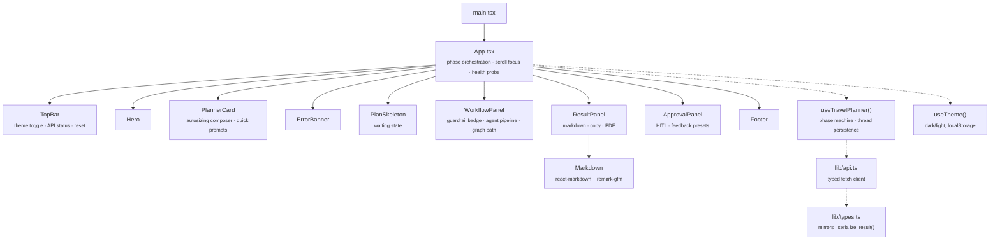
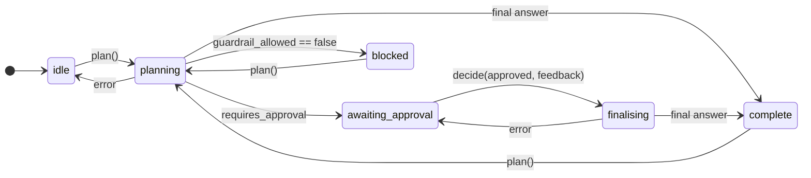

[← README](../README.md) &nbsp;·&nbsp; [Getting Started](getting-started.md) &nbsp;·&nbsp; [Architecture](architecture.md) &nbsp;·&nbsp; [The Agent Layers](agents.md) &nbsp;·&nbsp; [The MCP Tool Fabric](mcp.md) &nbsp;·&nbsp; **Frontend** &nbsp;·&nbsp; [API Reference](api.md) &nbsp;·&nbsp; [Design Notes](design-notes.md)

---

# Frontend

*The React SPA: phase machine, component tree, and design system.*

## 🎨 Frontend Architecture

The front end is a **Vite + React 18 + TypeScript** SPA in `frontend/`, styled with Tailwind and
animated with Framer Motion. It is a rewrite of the original vanilla-JS page, built to
mirror the graph's phases rather than just render its output.

### The phase machine

`useTravelPlanner()` owns all planner state and exposes exactly one legal transition per phase —
which is what keeps impossible UI states unreachable:

Consequences the user actually feels:

- The composer **locks** in `awaiting_approval` and explains why, so a second plan cannot be
  started on a thread the server has paused.
- **Revise & Finalize** stays disabled until feedback is non-empty, mirroring the server's `400`.
  Both approval and revision produce the final plan; there is no second review cycle.
- An `inFlight` ref plus a `phaseRef` guard prevents double submits and stale-closure races.
- Errors return the machine to a phase the user can act from — a failed approval lands back in
  `awaiting_approval`, not in `idle` with the draft orphaned.

### Notable implementation details

| Detail | Why |
| --- | --- |
| **Typed API contract** | `lib/types.ts` mirrors `backend._serialize_result()` field for field, so a backend rename becomes a compile error rather than a blank panel. |
| **PDF export** | `html2pdf.js` loads with the application through the existing Vite source alias, so exporting an open draft does not require a later PDF-runtime chunk request. |
| **Light-forced PDF** | The export toggles a `.pdf-light` class so the snapshot is readable on white paper even when the UI is dark. |
| **`prefers-reduced-motion`** | A global media query collapses every animation to ~0 ms. |
| **Honest progress** | The backend does not stream, so `PlanSkeleton` lists workflow stages and explicitly says progress is unavailable; no timer marks stages complete. |
| **Health probe** | `GET /health` every 30 s drives the checking/online/offline label. It is liveness only, not a provider health check. |
| **Humanised errors** | `lib/api.ts`'s `humanise()` rewrites raw Groq error text (oversized request, rate limit, bad key, missing `uv`) into a plain-English, actionable message before it ever reaches `ErrorBanner`. |
| **Accessible focus** | A visible `:focus-visible` ring, real `<label>`s, `role="alert"` on errors, and semantic `<ol>` for the pipeline. |

---

## TripWeave design system

The existing React SPA and Tailwind stack are retained. `index.css` defines shared channel-triplet
CSS tokens on `:root` (light) and `html.dark`; existing theme storage keys are preserved.

| Element | Treatment |
| --- | --- |
| Palette | Warm ivory `#f6f4ee`, forest green `#275046`, restrained terracotta, semantic status colors |
| Typography | Instrument Serif for editorial headings; Plus Jakarta Sans for controls; JetBrains Mono for counters and graph details; system fallbacks |
| Surfaces | Solid paper cards, thin borders, modest radii and subtle shadows |
| Layout | Editorial hero; desktop guide beside the planner; stacked mobile workspace |
| Navigation | In-page planner/how-it-works anchors, API status, existing reset and theme controls |
| States | Waiting, errors, routing, draft, review and final output share the same tokens |
| Accessibility | Named textarea, visible focus, semantic navigation/lists, status and alert roles, reduced-motion CSS, mobile reset |
| Motion | No animated background or glowing borders; brief existing panel transitions and a waiting shimmer |
| Exports | Existing PDF transformations, eager runtime loading, forced white PDF palette, TripWeave filenames |

The Kyoto photograph is bundled locally in `src/assets/kyoto.jpg`; the image does not make an
external request at runtime. Photo by [Yannick de Vries on Unsplash](https://unsplash.com/photos/joBzbU-MkuE),
used under the [Unsplash License](https://unsplash.com/license). A visible credit remains on the image.
Google Fonts remains the original optional external font dependency; local system fallbacks apply.

`useTravelPlanner.ts`, `lib/api.ts` and `lib/types.ts` are unchanged. The only API-service edit is
the FastAPI documentation title. The health response text, internal storage/package identifiers,
model prompts, graph, database and MCP configuration are retained.

---

← [The MCP Tool Fabric](mcp.md) &nbsp;•&nbsp; [API Reference](api.md) →

